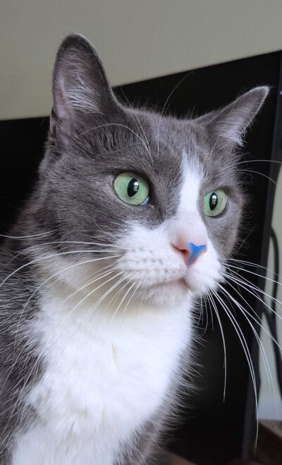

🚧 Migrating my repos to my personal forge 🚧
🚧 [git.drake.bot](https://www.git.drake.bot) 🚧

Software Engineer focused on user interfaces and developer tooling

Building my [PKM](https://en.wikipedia.org/wiki/Personal_knowledge_management) system with [Mog](https://github.com/bottd/mog), a
markup language I designed.

- Personal Website: [drake.dev](https://drake.dev)

### Some Deployed Projects

[deadlog.io](https://www.deadlog.io)
[votes.at](https://www.votes.at)

